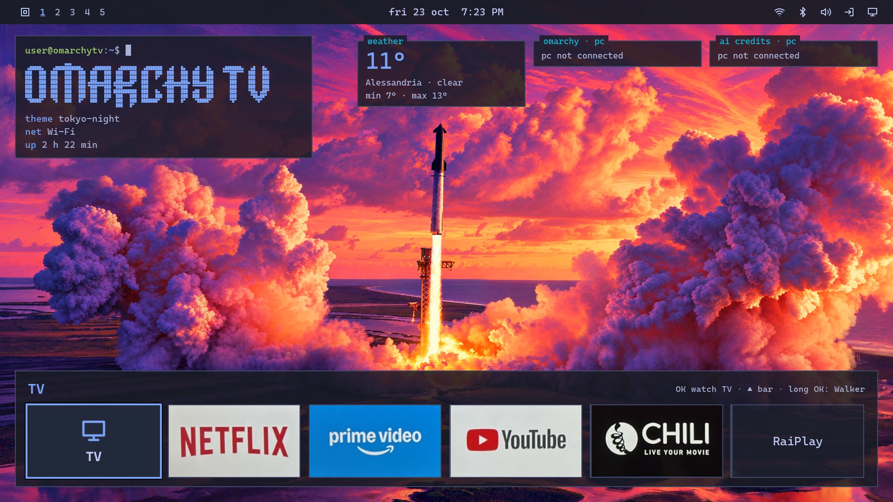
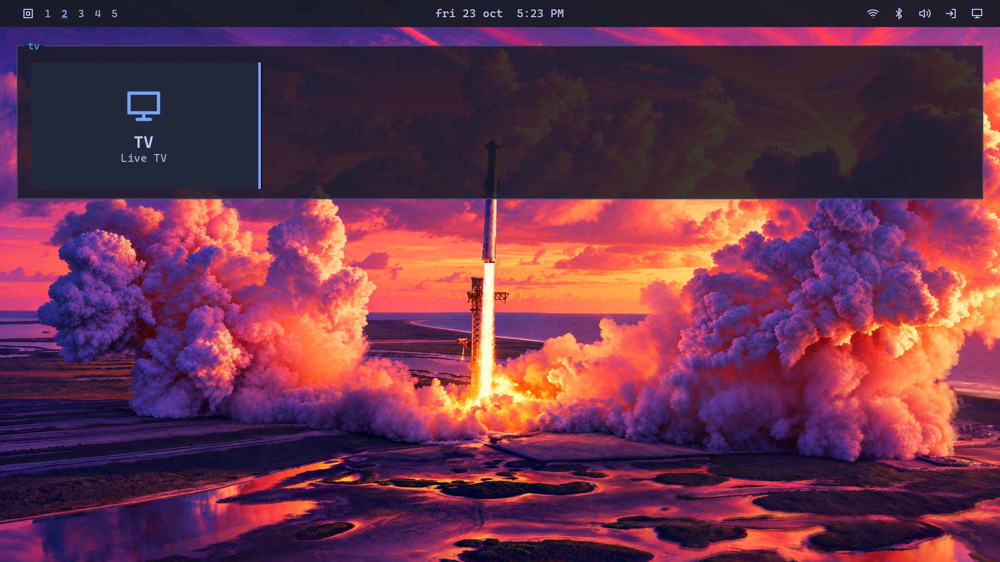
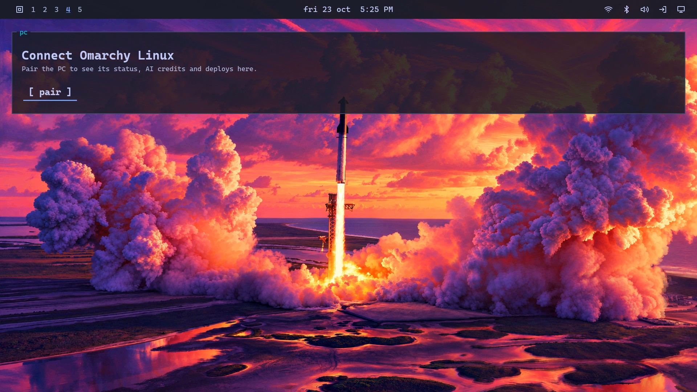
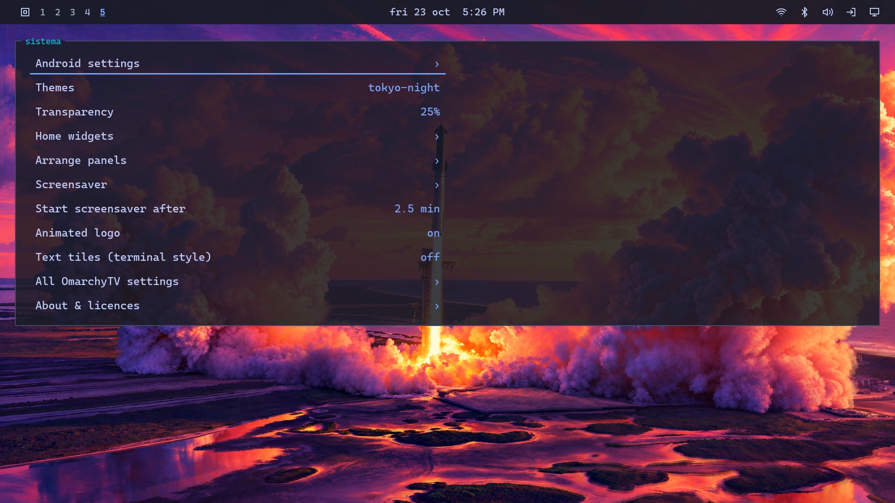
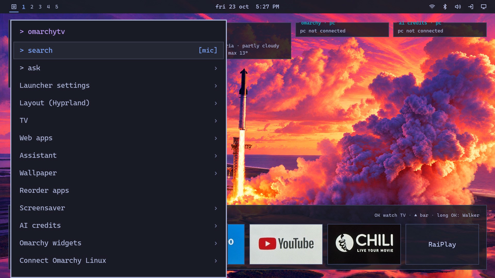
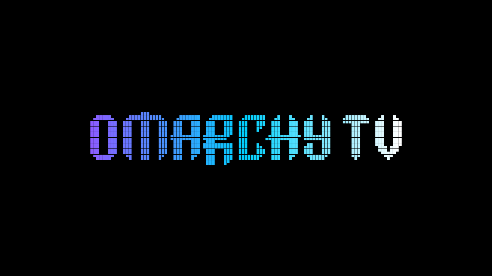
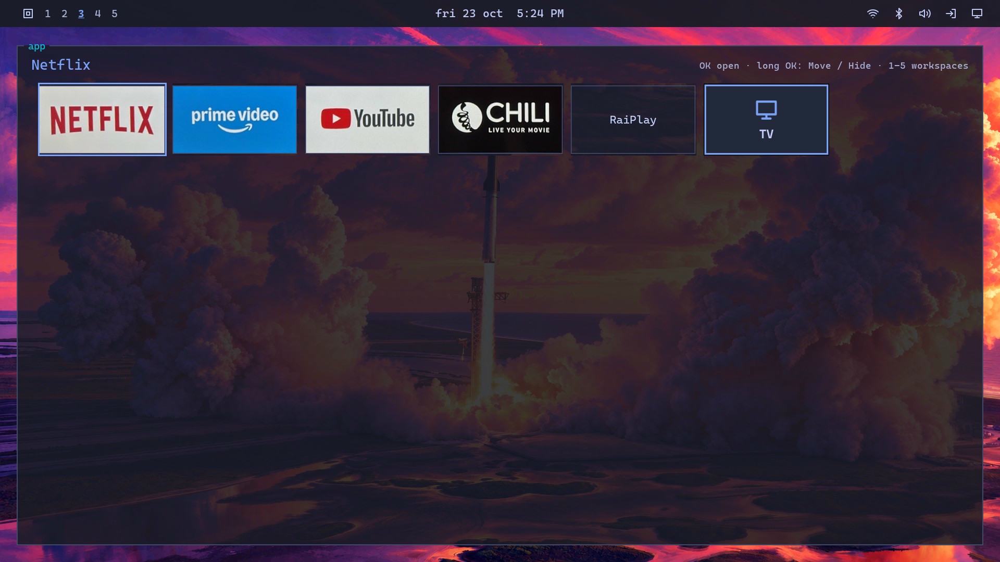

# OmarchyTV

**An Omarchy-style home screen for Android TV, plus a desktop link to your Omarchy PC.**

Created by **Marco Porro** · based on [tv-vibehack](https://github.com/Gathin23/tv-vibehack) by **Gathin**
· [X / @MarcoPorro](https://x.com/MarcoPorro) · [marcoporro.it](https://www.marcoporro.it)

Published: **23 October 2026 (beta)** · Version **2.11.0-beta** · License **MIT**

> [!WARNING]
> **BETA SOFTWARE: THINGS MAY NOT WORK.** OmarchyTV has been tested on a few devices (Sony KD-55XE9005 on Android 9,
> Google TV Streamer, Noblex/Hisense) plus the Android TV emulator. Expect rough edges, missing features on some TVs and bugs. It never roots or uninstalls
> anything, and you can always switch back to the stock home screen (see [INSTALL](launcher/docs/INSTALL.md)), but use it at your own risk.

*Default theme since 2.10.2-beta: Tokyo Night with Tom Ballard's "Liftoff Sunset" wallpaper, used with permission (see [Credits](#credits-and-third-party-software)).*

| Workspace 2 · TV | Workspace 4 · PC | Workspace 5 |
|---|---|---|
|  |  |  |
| **Logo menu** | **Screensaver (tte effects)** | **Workspace 3** |
|  |  |  |

*Screenshots from the Android TV emulator (API 28, 1920×1080, English UI) with the public 2.10.2-beta build. The app
tiles (Netflix, Prime Video, YouTube, CHILI, RaiPlay) are the real app icons captured on a Sony KD-55XE9005 running
OmarchyTV; see [Trademarks](#trademarks).*

---

## Features

### TV launcher (`com.omarchytv.home`)
- **Omarchy look**: Hyprland-style windows, Waybar-style top bar, Walker-style menus, CaskaydiaMono font.
- **Workspaces 1–5** like Hyprland: 1 home, 2 TV, 3 apps, 4 PC, 5 system. Number keys or the bar switch them.
- **TV tile**: one press to Live TV / the TV's inputs.
- **Default theme/wallpaper**: "Liftoff Sunset" by **Tom Ballard** ([@tcballard](https://x.com/tcballard),
  [omarchy-theme-tokyo-liftoff](https://github.com/tcballard/omarchy-theme-tokyo-liftoff)), used with permission.
- **Themes**: all 23 Omarchy themes (palettes from Omarchy), the Omarchy wordmark background for each,
  "next background", your own image, a procedural fallback, and custom themes pushed from your PC.
- **Panels**: every panel (clock, weather, PC stats, AI credits, deploys, terminal…) has its own toggle, and
  **Disponi riquadri** (arrange panels) lets you place them on a grid with the remote.
- **Reorder apps** in the row; the row title shows the focused app; **text tiles** for apps without a banner.
- **Animated OMARCHY logo** (on by default, several text effects).
- **Screensaver**: the 37 effects of tte.js / TerminalTextEffects, with a native fallback for old WebViews and a
  placeholder so it is never a black screen; also works as the system screensaver (Daydream).
- **Cast to TV** (opt-in): text, links, images, video and audio from your PC over the paired link.
- **Omarchy Link** (opt-in): pairing with your Omarchy PC, signed requests, live events.
- Debloat helper uses only `pm disable-user` (never uninstall), never touches DNS; a one-press "Originale"
  switch returns to the stock launcher.
- Every feature is optional and off by default, except the animated logo.

### PC side: `omarchy-tv` + `omarchy-link` (Omarchy Linux) — [pc-plugin/](pc-plugin/README.md)
- **Pairing** with a 6-digit code shown on the TV (SPAKE2), per-PC token, LAN only.
- **Auto-reconnect** after TV/PC restarts and network drops.
- **Stats** (CPU, RAM, now playing, deploys) every 5 s, only while the TV home is visible.
- **Theme sync and theme push**: the active Omarchy theme follows to the TV; `omarchy-tv themes push` sends your
  custom themes and backgrounds (up to 50 MB in total on the TV, strictly validated).
- **APK update** over adb (`omarchy-tv update`), refusing any APK with a different certificate or a lower version.
- **Live screen sharing ("Schermo PC")**: your Omarchy desktop on the TV as a low-latency H.264 stream
  (gpu-screen-recorder or wf-recorder, hardware encoding when available, optional audio), started from the PC or
  from the TV (the PC asks to confirm). Not Wi-Fi Direct Miracast, which is unreliable on Linux.
- **Custom app icons** (2.11.0+): your own PNG tile for any app, `omarchy-tv icons push` ([how-to](pc-plugin/omarchy-tv/README.md#custom-app-icons)).
- **Remote**: Home, Back, media keys and app launching from the PC; Waybar widget and desktop notifications.
- Omarchy-official look: Walker menu, gum fallback in the terminal, colours of the active theme, notify-send.

## Install (summary)
1. Enable Developer options and network debugging on the TV.
2. `adb connect <tv-ip>:5555`, then `adb install -r omarchytv-release-2.11.0.apk`.
3. Choose OmarchyTV as the home app (the installer script verifies it and rolls back on failure).
4. Optional: install the PC plugin on your Omarchy PC ([pc-plugin/README.md](pc-plugin/README.md)) and pair from
   *Connect Omarchy Linux*.

Full guide (English + Italiano), checksums and the signing-certificate fingerprint: **[docs/INSTALL.md](launcher/docs/INSTALL.md)**.

- Safe, reversible debloat (backup, `pm disable-user --user 0`, re-enable, safe vs never-touch packages): **[docs/DEBLOAT.md](docs/DEBLOAT.md)**
- Setup with an AI assistant (Claude Code, Codex, Gemini CLI, Cursor, ChatGPT, Grok Bot): **[docs/AI-ASSISTED-SETUP.md](docs/AI-ASSISTED-SETUP.md)**
Signing certificate SHA-256: `90aa68d9f45e623eadfd349ab1eb66042356f95ff6347a4568c3f3a78f8ea33d`.

## Compatible devices
- **Works**: Android TV and Google TV devices (Android 9+). Tested on Sony KD-55XE9005 (Android 9), Google TV Streamer
  (Android 14) and Noblex/Hisense (Android 11). Needs network debugging / adb.
- **Untested**: Fire OS devices (Fire TV Stick 4K Max / 4K Plus, Android-based) and projectors with Android TV
  (e.g. JMGO global versions).
- **Not supported**: LG webOS, Samsung Tizen, Fire TV Stick 4K Select (Amazon Vega OS, not Android), Roku, Apple TV.
- **Tip**: on a non-Android TV, plug in an Android TV / Google TV stick.

## Tested TVs
| TV | Android | WebView | OmarchyTV | Status | Notes |
|---|---|---|---|---|---|
| Sony KD-55XE9005 (2017) | 9 | 138 | 2.10.1-beta | pending real-TV test | 2.9 installed and working |
| Android TV emulator (API 28, x86) | 9 | 66 | 2.10.1-beta | ok (software rendering) | tte.js needs WebView ≥ 72: fallback used |
| Google TV Streamer | 14 | ? | 2.11.0-beta | ok (community) | tested by @TheFifeDawg |
| Noblex TV (Hisense platform) | 11 | ? | 2.10.x-beta | partial (community) | tested by @ilafayajose; installed apps missing on 2.10 (fixed in 2.11.0-beta, confirmation pending) |

Tested yours? Open an issue with the "TV report" template.

## Trademarks
Netflix, Prime Video, YouTube, Google, Android, Android TV, Google TV, Chromecast, Sony, BRAVIA, X, Disney+, Spotify
and all other product names, logos and app icons are trademarks of their respective owners. They appear only to
identify apps installed on your TV; app icons are loaded from the TV and are not bundled. "Omarchy" and its logo
are the Omarchy project's branding. OmarchyTV is an unofficial fan project, not affiliated with or endorsed by any
of them.

## Thanks
A huge thank you to DHH for creating Omarchy (https://omarchy.org), the inspiration behind this project, and for his
kind support of OmarchyTV. ❤️ OmarchyTV is an unofficial community project and is not affiliated with Omarchy.

## Credits and third-party software
- **tv-vibehack / cleanyourtv** by Gathin (MIT): the original project this is built on
  ([original README](docs/UPSTREAM-README-tv-vibehack.md)).
- **Omarchy** by David Heinemeier Hansson and contributors (MIT): logo, icon, theme palettes, wordmark backgrounds.
- **"Liftoff Sunset"** (default Tokyo Night wallpaper) by **Tom Ballard** ([@tcballard](https://x.com/tcballard)), from
  [omarchy-theme-tokyo-liftoff](https://github.com/tcballard/omarchy-theme-tokyo-liftoff); original photograph SpaceX
  (public domain per author); included with the author's permission granted on X on Oct 22, 2026. Thank you, Tom!
- **tte.js** by Flavio Copes, **TerminalTextEffects** by ChrisBuilds, **ttfx** by 37signals/omacom (MIT).
- **Free My TV** contributors (MIT): on-device adb client port.
- **Cascadia Code / CaskaydiaMono** (Microsoft, SIL OFL 1.1) with Nerd Fonts patches (MIT).
- **AndroidX / Media3 ExoPlayer** (Apache 2.0).

Full list with sources, licences, modifications and licence texts: [THIRD-PARTY.md](THIRD-PARTY.md), [NOTICE](NOTICE).
Third-party wallpapers whose licence could not be verified are **not** included.

## License
MIT, see [LICENSE](LICENSE).
Copyright (c) 2026 Gathin · Copyright (c) 2026 Marco Porro (OmarchyTV).
